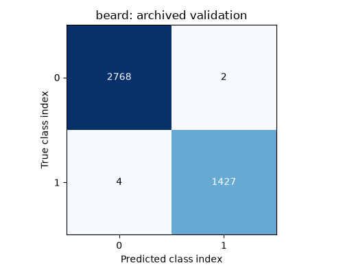
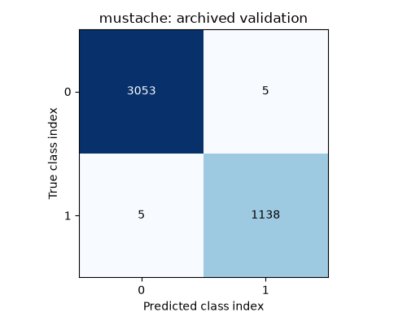
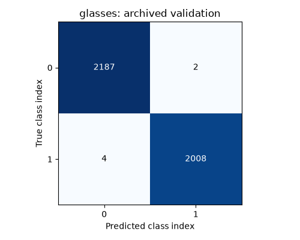
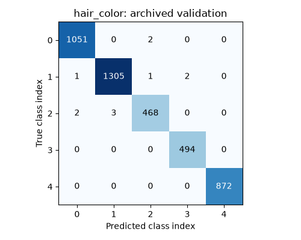
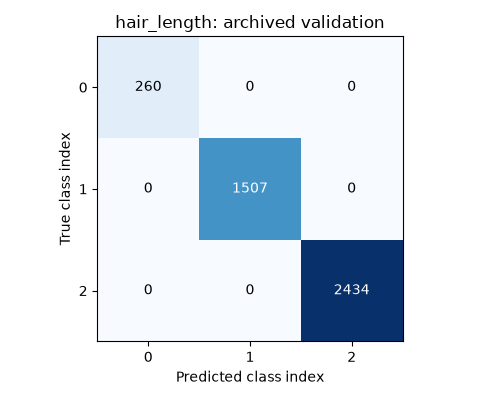

# Archived validation results

These counts were already committed in the repository. They have not been rerun or independently verified.
The old evaluator used the same `train_test_split(test_size=0.2, random_state=42)` as training and Hyperopt.
Its so-called test partition was therefore the validation partition used for model selection.
**These are historical validation results, not independent test performance.**

Accuracy and macro F1 below are recalculated from the archived confusion matrices; no predictions are invented.

| Attribute | Accuracy | Macro F1 | Support | Errors in archived matrix |
|---|---:|---:|---:|---:|
| beard | 0.9986 | 0.9984 | 4201 | 6 |
| mustache | 0.9976 | 0.9970 | 4201 | 10 |
| glasses | 0.9986 | 0.9986 | 4201 | 6 |
| hair_color | 0.9974 | 0.9969 | 4201 | 11 |
| hair_length | 1.0000 | 1.0000 | 4201 | 0 |

## Missing evidence

The original images and trained checkpoint are unavailable in this checkout. No identity annotations are present. The absence of duplicate filenames does not establish the absence of duplicate images.

The archive has no aligned per-image true/predicted labels, so real error examples cannot be recovered from these matrices. None are fabricated.

The committed annotations have 21,003 rows (s1: 15,890; s5: 2,613; s6: 2,500), consistent with the historical evaluation size of 4,201, but this does not prove which images were decoded.

The former preprocessing silently skipped missing images while keeping all annotation filenames. The former training summary also saved last-epoch accuracies under the name `best_accuracies`. The archived training JSON is preserved as evidence, not presented as verified best-checkpoint metrics.

## Confusion matrices

Rows are true labels; columns are predictions. Indices follow the original CSV.

### beard

### mustache

### glasses

### hair_color

### hair_length

